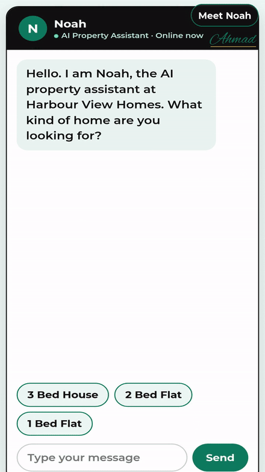

# Harbour View Homes — AI Property Assistant Demo

**Watch the agent work:** Noah, the AI property assistant, takes a buyer from first message to a confirmed viewing.

A working demo website for a fictional real estate agency in London, built to show how an AI agent handles property enquiries and viewing bookings on an agency website.

## The business

Harbour View Homes, a real estate agency in London. Its customers are buyers and renters searching on their phones, often in the evening after work. They shortlist fast and they enquire with the agency that replies first.

## The problem

This real estate agency loses buyers every week. Agents are out on viewings, the phone rings unanswered, and buyers move to the agency that replies first.

## What the AI agent does, step by step

1. Noah, the AI property assistant, greets the buyer in chat and replies in seconds, at any hour.
2. He matches the buyer with a real home in the price range: a 3 bedroom house in Greenwich for £625,000.
3. The buyer taps a day chip, then a time chip, straight from the open viewing times Noah shows.
4. Noah asks for the buyer name and confirms the viewing on the spot with a big confirmation card.
5. Noah sends a friendly reminder before the viewing, so buyers show up and diary slots stay full.

## Main features

- The agency site shows homes with full prices, star rated reviews and trust signals.
- The built in AI property assistant, Noah, chats with the buyer and completes a real viewing booking flow: home, day, time, name, and confirmation.
- Everything runs in one page with plain HTML, CSS and JavaScript. No build step. Open `index.html` in a browser and it works.

## Files

- `index.html` — the page structure and content
- `style.css` — all design and layout
- `script.js` — the AI property assistant logic: the chat, the viewing booking flow and the confirmation

## Tech used

HTML, CSS, JavaScript.

## Built by

Ahmad Raza, AI Full Stack Developer (Lahore, working with clients in the USA, UK and worldwide). I build AI Agents, websites and mobile apps for businesses.

This is a working demo built by Ahmad Raza to show what he builds for businesses like this. The agency is fictional, made to show the booking agent in action.
