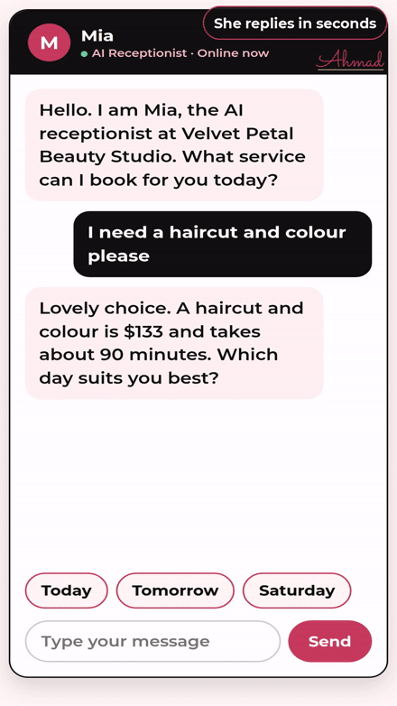

# Velvet Petal Beauty Studio — AI Booking Agent Demo

**Watch the agent work:** Mia, the AI receptionist, takes a client from first message to a confirmed booking.

A working demo website for a fictional beauty salon in New York, built to show how an AI agent handles salon bookings on a salon website.

## The business

Velvet Petal Beauty Studio, a beauty salon in New York. Its clients are busy women booking hair, nails and facials on their phones, often in the evening or at lunch.

## The problem

This beauty salon loses bookings every week. The phone rings, the stylists are busy with clients, and callers book the salon down the street.

## What the AI agent does, step by step

1. Mia, the AI receptionist, greets the client in chat and replies in seconds, at any hour.
2. She shows the service, price and time: a haircut and colour is $133 and takes about 90 minutes.
3. The client taps a day chip, then a time chip, straight from the open times Mia shows.
4. Mia asks for the client name and confirms the booking on the spot with a big confirmation card.
5. Mia sends a friendly reminder before the visit, so clients show up and chairs stay full.

## Main features

- The salon site shows services with full prices, star rated reviews and trust signals.
- The built in AI receptionist, Mia, chats with the client and completes a real booking flow: service, day, time, name, and confirmation.
- Everything runs in one page with plain HTML, CSS and JavaScript. No build step. Open `index.html` in a browser and it works.

## Files

- `index.html` — the page structure and content
- `style.css` — all design and layout
- `script.js` — the AI receptionist logic: the chat, the booking flow and the confirmation

## Tech used

HTML, CSS, JavaScript.

## Built by

Ahmad Raza, AI Full Stack Developer (Lahore, working with clients in the USA, UK and worldwide). I build AI Agents, websites and mobile apps for businesses.

This is a working demo built by Ahmad Raza to show what he builds for businesses like this. The salon is fictional, made to show the booking agent in action.
